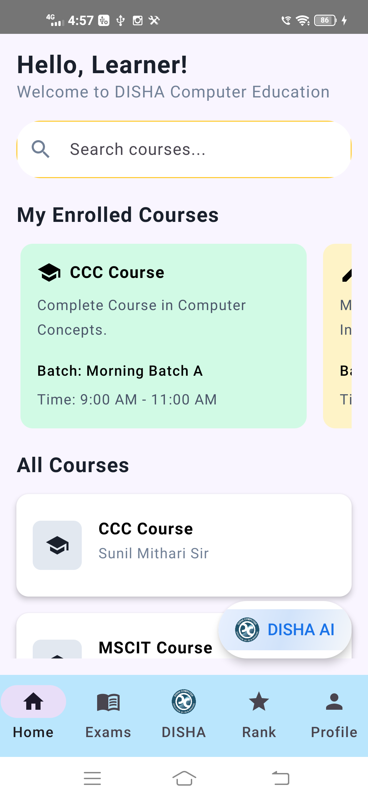

# 🎓 DISHA Computer — Student Learning App (Kotlin + Jetpack Compose)


The official **student app of DISHA Computer Education, Haladi** — institute courses and topics, topic-wise
**practice quizzes**, scheduled **certification exams with strict anti-cheat rules**, result review,
ranking, and a built-in **DISHA AI** study assistant. 100% Kotlin + Jetpack Compose.

📲 **Live on Google Play:** **[DISHA Computer](https://play.google.com/store/apps/details?id=com.avinashpatil.app.dishacomputer)**


## 👀 Quick scan (30 seconds)

| What you want | Proof in this repo |
|---|---|
| Kotlin + Jetpack Compose, Material 3 | 20 Compose screen files in `screens/` (~9.4k lines) |
| Coroutines & Flow, MVVM | 12 ViewModels using `StateFlow` / `MutableStateFlow` + `viewModelScope` |
| Dagger Hilt + Retrofit + Room | `di/NetworkModule.kt`, `di/DatabaseModule.kt`, **35 REST endpoints**, 5 Room entities + 5 DAOs |
| Real authentication | JWT **access + refresh** tokens in DataStore (`TokenManager`), `AuthInterceptor` + `TokenAuthenticator` (`okhttp3.Authenticator`) |
| Anti-cheat exam engine | Total + per-question `CountDownTimer`, **CameraX front-camera monitoring**, app-switch / back-press force-submit counters |
| Offline-friendly data layer | Topics and quizzes exposed as Room `Flow`s (`TopicsDao`, `QuizDao`) and refreshed from the API; answer sheets persisted locally via `ExamAnswerDao` |
| Ships to real users | Published on **Google Play**, `versionName 3.0.0` / `versionCode 4` (Mar 2026 update) |
| Testing mindset (TDD) | 27 JVM unit tests in `app/src/test/` — `./gradlew :app:testDebugUnitTest` |

**Scale:** 84 Kotlin files · ~14.9k lines · 20 Compose screen files (17 wired routes) · 35 API endpoints · 6 repositories · 12 ViewModels · 5 Room entities.

## 📱 Screenshots

<table>
  <tr>
    <td align="center"><br/>In-app screen (device capture)</td>
  </tr>
</table>

## ✨ Features

- **🔐 Institute-issued login** — students sign in with their **Email ID + DISHA ID** (the DISHA ID is the
  credential the institute issues, masked behind a show/hide toggle). Session = JWT access + refresh pair.
- **📚 Courses & topics** — enrolled courses plus the full course list, each course expanding into topics;
  course/topic/question data is served from the backend and cached in Room.
- **📝 Practice quizzes** — topic-wise practice with a **30-second per-question timer** and a **30-minute
  total timer**, auto-advance when the timer runs out, and instant colour-coded feedback.
- **🎯 Certification / final exams** — exam list shows duration and scheduled date-time and validates
  access before allowing entry (`QuizViewModel`/`ExamScreen` access checks + `attempted` flag), then a
  pre-exam instructions screen (`ModernInstructionsScreen`) leads into the exam.
- **🛡️ Exam integrity** — during a final exam the app runs a **strict total countdown**, keeps the
  **front camera preview active** (CameraX, `CameraPreview.kt`), warns on backgrounding/back-press and
  auto-submits after repeated violations (`FinalExamViewModel` counters + warning dialogs).
- **📊 Results & review** — separate result screens for practice and certification exams with score,
  correct/wrong/skipped stats and an animated circular score indicator; the certification result screen
  adds a per-question review section with correct/incorrect highlighting.
- **🏆 Ranking** — a ranked table (rank, avatar, student name, score) with a name search field.
- **🤖 DISHA AI** — in-app chat assistant (OpenRouter chat-completions, `openai/gpt-oss-120b:free`) with
  conversation history, error surfacing and **retry with exponential backoff** (up to 10 attempts).
- **👤 Profile** — live user profile from the API/Room cache, profile-image picking, course details,
  and a **logout that requires institute/admin permission** (the app explicitly warns that a logged-out
  device cannot sign in again without admin approval).
- **🚫 Backend-driven account lock** — if the backend answers with `Account is locked`, `LockInterceptor`
  flips a DataStore flag, `MainViewModel` observes it and navigation immediately routes to the
  **"Account Locked" restriction screen**.
- **🧾 Bill / fee details** — all-in-one bill and student-details screens showing course, batch and
  payment breakdown (Total Price / Given Price / Remaining Price) resolved from the backend.

## 🔐 Auth, device binding & account lock

```
Login (email + DISHA ID)
   → POST api/auth/login → { accessToken, refreshToken } → DataStore (TokenManager)
   → AuthInterceptor      : adds "Authorization: Bearer <accessToken>" to every call
   → TokenAuthenticator   : on 401, POST api/auth/regenerate-token and replays the call
   → LockInterceptor      : peeks 4 KB of every response for "Account is locked"
                            → sets UserPreferences.userLockStatus → RestrictionScreen
```

One device = one approved student session: the institute grants the login, and logging out from the device
requires the admin to authorise signing in again.

## 🏗️ How the app is wired

```
Compose screen (screens/)
   → Hilt ViewModel (viewmodel/)  — StateFlow / UiState
      → Repository (repository/)  — Room cache first, API refresh
         → Retrofit (api/)  ⟷  Room (data/)  ⟷  DataStore (tokens, lock state, prefs)
```

**Start reading here**

1. `app/src/main/java/.../navigation/AppNavigation.kt` — every route, bottom-nav visibility rules and the lock redirect
2. `network/AuthInterceptor.kt` + `network/TokenAuthenticator.kt` — token injection and silent refresh
3. `viewmodel/FinalExamViewModel.kt` — timers, warnings, force-submit counters, submission
4. `repository/QuizRepository.kt` — API + Room (`QuizDao`, `ExamAnswerDao`) answer persistence
5. `di/NetworkModule.kt` — Retrofit/OkHttp wiring (timeouts, logging, retry interceptor)

## 🗂️ Project structure

```
app/src/main/java/com/avinashpatil/app/dishacomputer/
├── api/            # Retrofit services + DTOs (35 endpoints)
├── data/           # Room database, entities, DAOs, DataStore, converters
├── di/             # NetworkModule, DatabaseModule (Hilt)
├── network/        # AuthInterceptor, TokenAuthenticator, LockInterceptor, GeminiService (OpenRouter)
├── repository/     # Auth, User, Course, Topics, Quiz, Exam repositories
├── screens/        # 20 Compose screens (home, topics, quiz, exam, results, ranking, profile, AI, bill)
├── viewmodel/      # 12 Hilt ViewModels
└── ui/theme/       # Material 3 theme, colour and type
```

## 🌐 Backend API surface (highlights)

| Area | Endpoints |
|---|---|
| Auth | `POST api/auth/login`, `POST api/auth/logout`, `POST api/auth/regenerate-token` |
| Courses / topics | `GET api/courses`, `GET api/courses/{id}`, `POST api/courses`, `GET api/questions/courses/topics/{topicId}` |
| Batches / users | `GET api/batches/{id}`, `GET api/users/{id}`, `GET api/users/all`, `POST api/users/register` |
| Quizzes & questions | `GET api/quizzes/courses/{courseId}`, `GET api/quizzes/courses/quizzes/{quizId}`, `GET api/questions/quiz/{quizId}`, `POST api/questions` |
| Exams | `POST api/quizzes/submit-quiz`, `GET api/exams/result/{examId}` |
| Progress | `GET api/leaderboard`, `GET api/certificates/user/{userId}`, `POST api/certificates` |

The base URL is defined in `api/RetrofitClient.kt`; the app talks to the institute's own REST backend.

## 🧪 Tests

27 JVM unit tests cover the parts of the app that are pure logic, so no emulator is needed:

| Suite | What it pins down |
|---|---|
| `ConvertersTest` (5) | Room type converters for the enum/date payloads in the offline cache |
| `ErrorUtilsTest` (5) | Friendly message mapping for HTTP, timeout and DNS failures |
| `ExamRepositoryTest` (8) | Exam result fetching and submission handling |
| `OpenRouterApiServiceTest` (9) | DISHA AI request/response shape, and the retry path |

```bash
./gradlew :app:testDebugUnitTest
```

## 🚀 Build & run

Requirements: **Android Studio (latest)**, **JDK 11**, Android SDK with **compileSdk 35**, a device/emulator on **API 29+**.

```bash
git clone https://github.com/Avi6855/DISHA_Computer.git
cd DISHA_Computer
# optional: enable the AI assistant locally
echo "OPENROUTER_API_KEY=your_key_here" >> local.properties   # local.properties is gitignored
./gradlew :app:assembleDebug   # build the debug APK
./gradlew :app:testDebugUnitTest   # run the 27 unit tests
```

Notes:

- The DISHA AI screen reads its key from `BuildConfig.OPENROUTER_API_KEY`, which is populated from
  `local.properties` / Gradle property `OPENROUTER_API_KEY`. Without a key the chat screen reports
  "OpenRouter API key is missing" instead of crashing.
- `local.properties` and `google-services.json` are gitignored — no credentials are committed.
- Auth needs the institute backend reachable from the device; without it the app opens but login/course
  data will fail.

## 🧭 Roadmap / known gaps (honest list)

- **Ranking screen currently renders sample rows** (`screens/ranking/RankingScreen.kt` holds 18 hardcoded
  `RankingItem`s with real names/avatars) — the `GET api/leaderboard` endpoint and `LeaderboardUser` model
  exist, so the next step is to bind the screen to the API and drop the sample data.
- **Cleartext HTTP to the institute server** (`android:usesCleartextTraffic="true"`) — should move to HTTPS
  and a configurable base URL before any wider release.
- **Instrumented tests are still the generated template** — `ExampleInstrumentedTest` is a placeholder, so the
  exam timers, camera monitoring and other UI flows are only covered by unit tests today.
- **HTML design mockups are committed inside the source tree** — 10 `.html` files (e.g. `screens/home/index.html`,
  `screens/profile/ModernProfileScreen.html`) sit beside the Compose screens; moving them to a `design/`
  folder or removing them would keep the module clean. `screens/bill/DummyData.kt` is also fully commented out.

## 👤 Author

**Avinash Rajendra Patil** — Android developer (Kotlin, Jetpack Compose)
📧 avinashpatil6855@gmail.com · GitHub [@Avi6855](https://github.com/Avi6855)

Companion admin console: [AdminDISHA](https://github.com/Avi6855/AdminDISHA)
